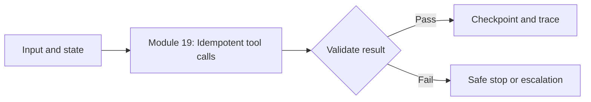
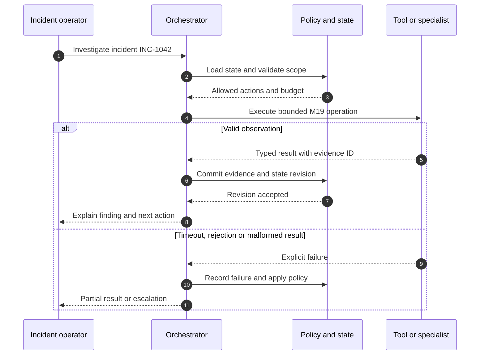
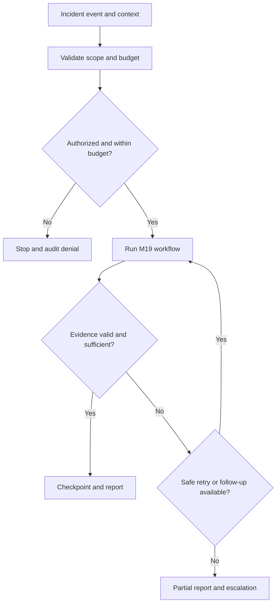

# Module 19 — Idempotent tool calls

## Learning objective

Explain the concept, implement its control boundary, identify its failure mode, and defend the trade-off in a production architecture review.

## Technical explanation

Idempotency ensures replay does not duplicate effects. In the reference incident-response workflow, the operational question is not only whether the agent can produce a diagnosis, but whether the system can prove which evidence and permissions led to that diagnosis. Persist request identity and outcome atomically.

## Workflow diagram

## Implementation touchpoint

Inspect `src/agentops/core.py`, `src/agentops/api.py`, and `docs/architecture.md`. The baseline demonstrates typed state, tool observations, bounded execution, persistence, and approval. **This module's complete production capability may be an extension exercise rather than implemented functionality.** Check the [readiness register](../docs/production-readiness.md) before making deployment claims.

## Failure analysis

Same key with different payload must be rejected. Design a negative test that proves the workflow stops or escalates rather than silently proceeding.

## Hands-on lab

1. Run the baseline incident `INC-1042` and inspect the returned `trace_id`, `audit`, `steps`, and `evidence`.
2. Draw the trust boundary relevant to **Idempotent tool calls** and annotate which transitions need validation.
3. Implement one additional typed policy or test in `core.py` / `tests/`, keeping default behavior backwards compatible.
4. Introduce a failure (malformed tool result, unavailable dependency, duplicate request, or unauthorized action) and verify the safe outcome.
5. Record before/after test output, execution cost proxy (step count), and architectural trade-offs.

## Architecture review questions

- What is the source of truth and who may mutate it?
- What should happen when this component times out or returns an invalid result?
- How would you prove that no unauthorized side effect occurred?
- Which signals would you monitor after a canary rollout?

## Completion criteria

A passing automated negative test, a documented decision, a revised sequence diagram, and a concise explanation of when this pattern should **not** be used.

---

## Illustrated real-world walkthrough: Idempotent Tool Calls

**Scenario.** A webhook delivers the same approval event twice.

### Sequence of events

1. **Trigger:** A request or event is recorded with a stable incident identifier and trace context.
2. **Decision and execution:** Compute an idempotency key from incident, action and approved revision; atomically reserve it; return the stored result for duplicate deliveries.
3. **Verification:** Compare each returned observation with the requested schema, evidence provenance, and policy constraints.
4. **Exit:** Record the resulting state, trace, and an explicit outcome: success, partial result, denied, or escalated.

### Decision workflow

### Example inputs and outputs

| Artifact | Example |
|---|---|
| Incident | `INC-1042`, service `checkout-api`, 5xx alert |
| Input evidence | Error-rate window, release revision, and runbook IDs (where applicable) |
| Successful output | Structured finding with evidence references and next-step recommendation |
| Safe failure output | Typed error, reason for stop, and retained prior evidence |

**Production safeguard:** Key storage and side-effect execution need a crash-safe reconciliation strategy.

**Practice task:** Trace this scenario on paper and implement a negative test proving the safeguard; distinguish what is already in the deterministic baseline from a proposed extension.

**Interview challenge:** What if the worker dies after the action but before recording success?
