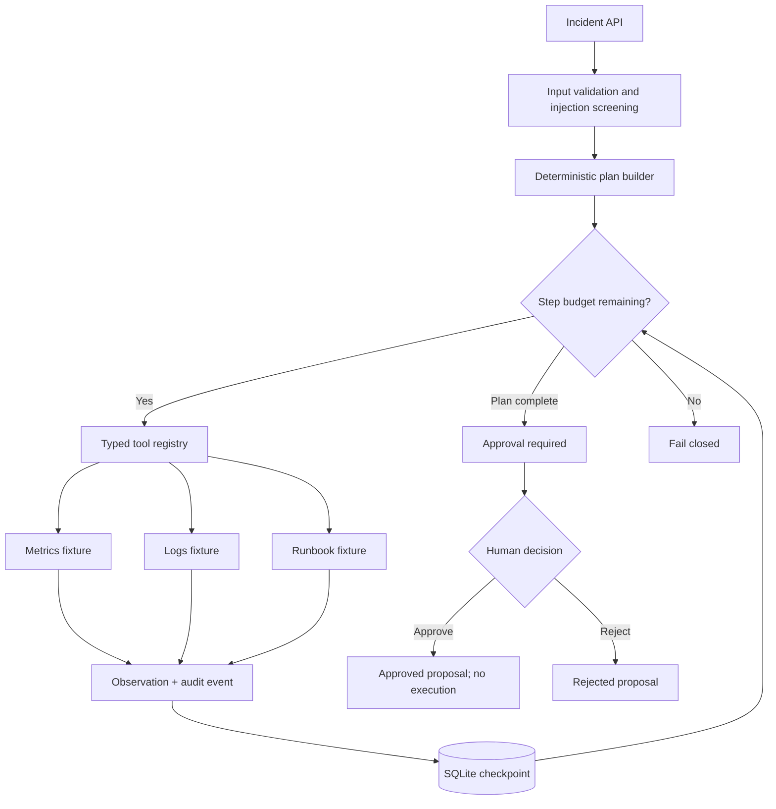
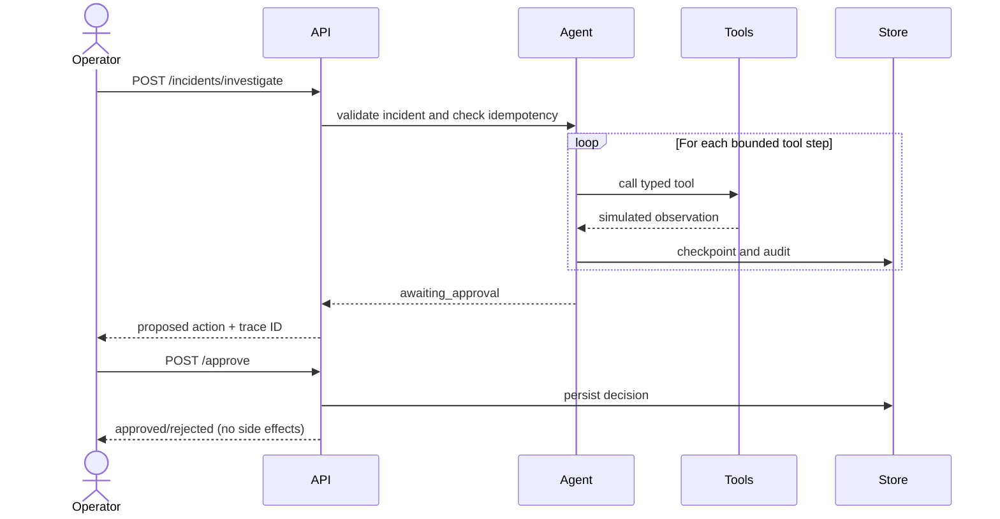

# Original reference architecture

## Incident sequence

## Design constraints

State is a validated Pydantic model. The checkpoint store persists per incident ID. Tool results are simulation fixtures and should be treated as untrusted if replaced with live data. Approval never executes a real remediation. SQLite is for a local single-process lab, not a horizontally scaled deployment.
