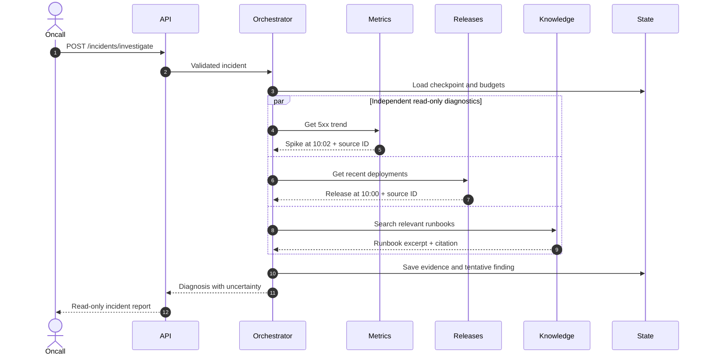
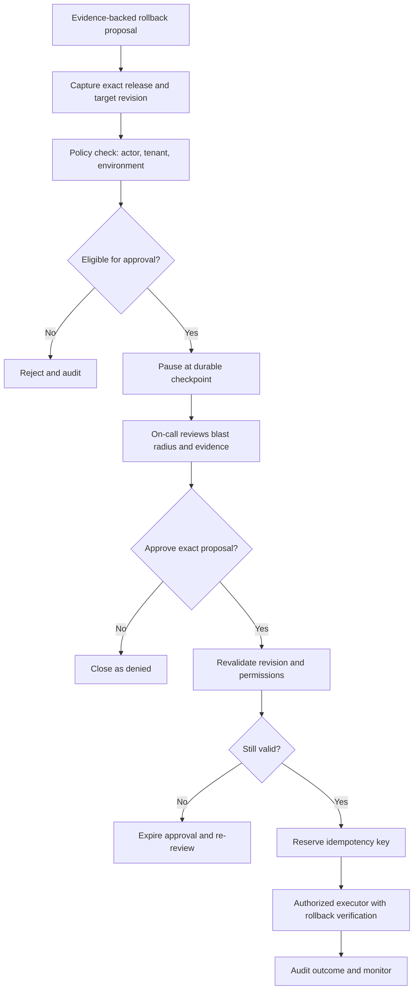
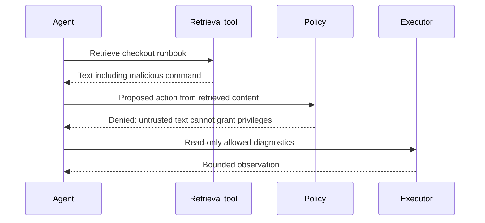
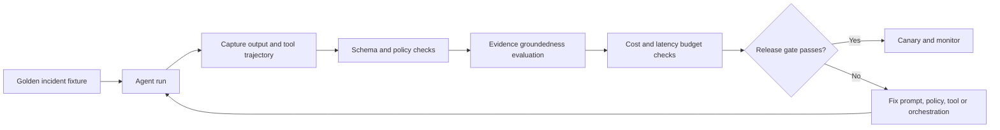

# Illustrated end-to-end workflows

These diagrams are original instructional designs. They depict a target architecture; the current runnable baseline is deterministic and does not connect to live telemetry or execute remediation.

## Workflow A — Diagnose a failed checkout deployment

**Walkthrough.** A deployment is temporally correlated with a spike in 5xx responses. That is a hypothesis, not proof of causation. The agent should request a discriminating signal (for example, compare healthy and unhealthy instances) before making a strong claim. If the metrics endpoint fails, the report is marked partial.

## Workflow B — Human-approved remediation

**Walkthrough.** An on-call engineer approves rollback of a specific service and release. Approval is not a generic permission token. A deployment change after approval invalidates the proposal; the executor must re-check. **The current baseline only records approval; it does not execute rollback.**

## Workflow C — Prompt injection through retrieval

**Walkthrough.** A retrieved runbook might contain instructions to export secrets. The agent may quote the suspicious text as evidence but must not treat it as an instruction. The authorization layer blocks secret access independently of model behavior.

## Workflow D — Reliability and evaluation loop

**Walkthrough.** A correct root-cause guess is insufficient if the agent attempted an unauthorized call. Evaluate task outcome, safety, tool sequence, groundedness, latency and cost independently. Compare multiple runs where inference is nondeterministic.

## Suggested learner assessment

For each workflow, learners submit: a traced happy path, a failure path, a diagram annotated with trust boundaries, a runnable test, and a short design trade-off explanation.
